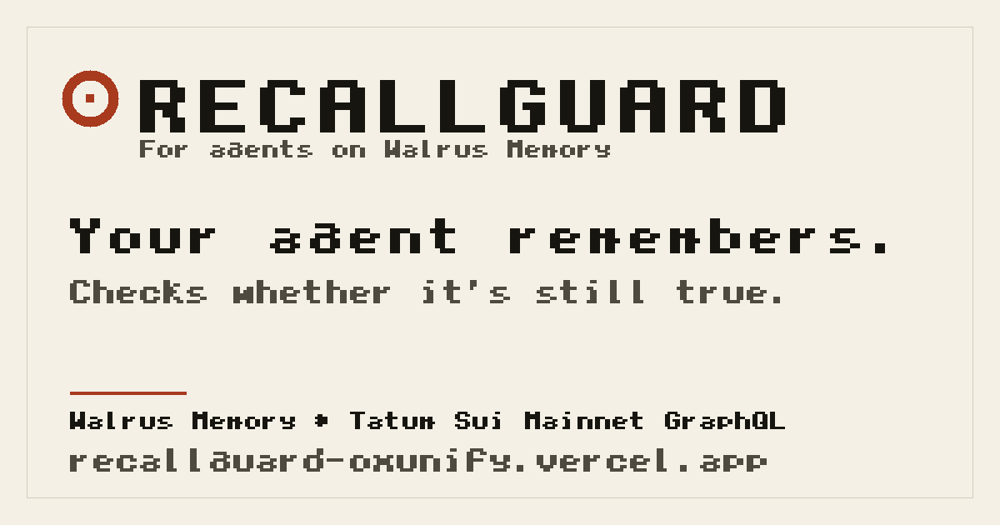

<div align="center">



&nbsp;

[](LICENSE)
[](#run-it-locally)
[](https://www.walrus.xyz)
[](https://tatum.io)
[](#tech-stack)

### Your agent remembers. RecallGuard checks whether it's still true.

Agent memory today answers one question: _can an agent recall across sessions?_ RecallGuard answers the harder one: **when an agent recalls a mutable onchain fact, can you prove it is still true before it acts on it?** Every Walrus-backed memory is checked against live Sui state through Tatum before it can become an answer. Changed or unverifiable claims are withheld; the verified value is used instead, and corrections supersede the stale record. Built for the **Tatum x Walrus Total Recall** hackathon, **Track 02: Smart Agents for Real Life**.

**[ Watch the demo ↗ ](#-demo)** &nbsp;·&nbsp; **[ Live site ↗ ](https://recallguard-oxunify.vercel.app)** &nbsp;·&nbsp; **[ Blog post ↗ ](https://recallguard-oxunify.vercel.app/blog.html)** &nbsp;·&nbsp; **[ How it works ↗ ](#how-it-works)** &nbsp;·&nbsp; **[ Run it locally ↗ ](#run-it-locally)**

</div>

---

## ▶ Demo

[](https://youtu.be/16bsUTPpyqw)

_The real product driven end to end. Twenty-two memories on Walrus Mainnet, a checkpoint-stamped decision log, and the recorded revision lifecycle `STALE → FRESH → STALE`, replayable offline with no wallet and no credentials._

## Table of contents

- [The problem](#the-problem)
- [What I built](#what-i-built)
- [Architecture](#architecture)
- [How I integrated Walrus Memory and Tatum](#how-i-integrated-walrus-memory-and-tatum)
- [MCP: the product, not an adapter](#mcp-the-product-not-an-adapter)
- [Evidence](#evidence)
- [Mainnet proof](#mainnet-proof)
- [Safety contract](#safety-contract)
- [What is real vs modelled: the honesty table](#what-is-real-vs-modelled-the-honesty-table)
- [How it works](#how-it-works)
- [Tech stack](#tech-stack)
- [Run it locally](#run-it-locally)
- [Tests](#tests)
- [Honest limits](#honest-limits)
- [Links](#links)
- [License](#license)

---

## The problem

An agent recalls last week that a delegate key was authorized, the account moved overnight, and the agent reaches for the payment workflow it should not touch. A vector search can only tell you what a memory _sounds like_. It cannot tell you whether the underlying object moved. For mutable onchain facts (object versions, clocks, registries, config), the only thing that makes a remembered answer usable is proof that its evidence still holds.

| Recalled state | Risk without a gate | RecallGuard |
|---|---|---|
| The subject changed | An old value is returned as current | `STALE`; memory is withheld and the verified live value is shown |
| The subject is unchanged but the memory is old | A fixed timeout produces false staleness | `FALSE-STALE`; the learned window can widen |
| The subject changed inside the current window | A loose window misses a change | `MISSED-CHANGE`; the learned window can tighten |
| Verification is missing or malformed | The system guesses | Fails closed with `WITHHELD_UNVERIFIED` |
| A correction supersedes an observation | History is overwritten or disconnected | Both records remain addressable through explicit `supersedes` lineage |

## What I built

A freshness gate for AI-agent memory, shipped as a library, a CLI and an MCP server:

1. **Recall** a candidate memory from Walrus Memory (MemWal SDK), with its FR-v1 proof envelope: chain id, checkpoint, version/digest, read time.
2. **Load the freshness policy** for that claim class, also from Walrus, not from a hidden constant.
3. **Verify** against live Sui Mainnet state through Tatum: the latest checkpoint sequence/digest, and the subject object's current version and digest. At most two reads per answer, one cached for a second.
4. **Verdict.** FRESH returns the memory as the answer. STALE or unverifiable returns nothing; the answer is computed from the live read, and the recorded memory is withheld.

The gate is deterministic. There is no LLM between recall and the verdict.

## Architecture

```text
recall_checked(query)
  │
  ├─ recall candidate from Walrus Memory (MemWal SDK)
  │    └─ parse the FR-v1 proof envelope (chain id · checkpoint · version/digest · read time)
  ├─ load per-class policy memory (FALSE-STALE widens · MISSED-CHANGE tightens)
  ├─ freshness gate: fail closed
  │    ├─ latest Sui checkpoint via Tatum GraphQL · at most 1 cached read (1 s)
  │    ├─ current subject version + digest        · at most 1 read
  │    └─ wall-clock backstop
  ├─ FRESH → answer from verified memory
  └─ STALE / WITHHELD_UNVERIFIED → withhold memory and explain why
       └─ correction write only with explicit allow-writes + approval
```

| Component | Role | Path |
|---|---|---|
| MCP server | stdio, six tools, read-only default | [`scripts/recallguard-mcp.mjs`](scripts/recallguard-mcp.mjs) + [`src/mcp.mjs`](src/mcp.mjs) |
| Public CLI | Recorded replay and live read-only entry point | [`scripts/recall-checked.mjs`](scripts/recall-checked.mjs) |
| JavaScript contract | Stable `recall_checked/v1` responses | [`src/recall-checked.mjs`](src/recall-checked.mjs) |
| Gate | Window, subject pin, wall-clock, fail-closed validation | [`src/gate.mjs`](src/gate.mjs) |
| Policy engine | Loads and learns bounded per-class windows | [`src/policy.mjs`](src/policy.mjs) |
| Tatum transport | Sui Mainnet GraphQL reads, caching, retry, request budget | [`src/tatum.mjs`](src/tatum.mjs) |
| Walrus memory layer | Recall, parsing, correction lineage, policy records | [`src/store.mjs`](src/store.mjs) |
| Evidence | 22 memories, 306 checkpoint-stamped decisions | [`docs/evidence/proof-snapshot.json`](docs/evidence/proof-snapshot.json) |

## How I integrated Walrus Memory and Tatum

**Walrus Memory is the substrate, not the decoration.** Twenty-two memories were written to Walrus Mainnet on-chain and recalled back through the MemWal SDK: 7 observer observations, 4 corrections, 2 learned-policy records, 1 pre-anchor-fix adversarial specimen, and 8 live round-trip seeds. Each one is an immutable blob with a checkpoint stamp; revisions never overwrite, they supersede through `supersedes` lineage.

**Tatum is the chain-truth layer.** Every freshness decision reads the current checkpoint sequence/digest and the subject object's version and digest through the Tatum Sui Mainnet GraphQL gateway. The `x-api-key` header was observed on every measured request (21/21 in the controlled measurement, 7/7 in the final snapshot, 2,208/2,208 in the longer page run). At most two reads per answer, exponential backoff on 429 and timeouts, and fail-closed on anything missing or malformed. Tatum AI Builder was **not** used.

The novel bit is that the freshness policy itself is a memory. Two per-class policy records live in Walrus and were read back before every decision: FAST tightened from 50 to 25 checkpoints after 3 `MISSED-CHANGE` signals (`fc-policy-FAST-v1`); SLOW widened from 5,000 to 20,000 after `FALSE-STALE` signals (`fc-policy-SLOW-v2`). The same evidence under the built-in 5,000 window reads `STALE / FALSE-STALE`; under the persisted 20,000 window it reads `FRESH / CONSISTENT`. Deterministic replay with the policy as the only changed input; policy evaluation, not autonomous learning.

### A real revision can age before persistence

The recorded lifecycle reads `STALE → FRESH → STALE` precisely. The correction took 117,242 ms to reach Walrus; the first later check, 1,381 ms afterwards, already found the subject changed. History never gets rewritten: the predecessor blob, the correction blob, and the proof-equivalent observation the historical event recalled are all addressable, and the contract discloses that distinction.

## MCP: the product, not an adapter

RecallGuard speaks the Model Context Protocol over stdio. Point an MCP-compatible agent at it and enforce the gate on every onchain claim it makes:

```jsonc
// .mcp.json. Or run: claude mcp add recallguard -- node /absolute/path/to/recallguard/scripts/recallguard-mcp.mjs
{
  "mcpServers": {
    "recallguard": {
      "type": "stdio",
      "command": "node",
      "args": ["/absolute/path/to/recallguard/scripts/recallguard-mcp.mjs"]
    }
  }
}
```

```toml
# ~/.codex/config.toml. Or run: codex mcp add recallguard -- node /absolute/path/to/recallguard/scripts/recallguard-mcp.mjs
[mcp_servers.recallguard]
command = "node"
args = ["/absolute/path/to/recallguard/scripts/recallguard-mcp.mjs"]
```

Both configurations were run with isolated `HOME`s (Claude Code 2.1.318 reports `recallguard: … ✔ Connected`; codex-cli 0.167.0 lists the server `enabled`). Full reference and troubleshooting: [docs/mcp.md](docs/mcp.md).

Tools (all read-only except the explicitly gated write):

| Tool | What it does |
|---|---|
| `recall_checked` | Freshness-checked recall: returns the `recall_checked/v1` structured decision |
| `explain_decision` | Why the memory was accepted or withheld; evidence, policy, lineage |
| `list_revisions` | Revision chain + `supersedes` relationships from the committed snapshot |
| `get_evidence` | Provenance and verification evidence behind a blob id |
| `propose_correction` | Drafts a correction for review; never persists |
| `store_correction` | Persists only with `RECALLGUARD_ENABLE_WRITES=true` + `confirm="STORE-CORRECTION"` + live mode |

## Evidence

Everything is replayable from the committed snapshot; nothing below is asserted from adjectives. Open [CLAIMS.md](CLAIMS.md) for the full claim ledger, [docs/evidence/proof-snapshot.json](docs/evidence/proof-snapshot.json) for the raw record, and the [hosted static export](https://recallguard-oxunify.vercel.app) for a self-contained read.

- **22 recorded Mainnet memories** in namespace `freshness-recall`: 7 observations, 4 corrections, 2 policy records, 1 pre-fix adversarial specimen, 8 live round-trip seeds.
- **306 checkpoint-stamped decisions.** In the ungated path the recorded log divides into **214 changed** answers, **16 unchanged-but-old** answers, **4 unverified** answers: a modelled counterfactual analysis of the recorded log, not production incidents.
- **The learned policy changed a real verdict** (deterministic replay, window as the only input): `STALE / FALSE-STALE` at 5,000 vs `FRESH / CONSISTENT` at 20,000.
- **A real revision aged before persistence**: 117,242 ms to persist, first later check 1,381 ms afterwards withheld it.
- **Tatum access discipline**: `x-api-key` on every measured request (21/21, 7/7, 2,208/2,208); plan header observed; ≤ 2 reads per answer; exponential backoff on 429.

Labels matter: **recorded** (captured from Mainnet), **offline replay** (deterministic, this repository), **live** (requires credentials; one read-only Mainnet run verified 2026-11-10), **modelled** (counterfactual analysis).

## Mainnet proof

A controlled transfer between two disposable Sui keypairs, funded once and then destroyed after the sweep. The gate watched SUI balances through a `coin_balance` predicate: the pin is the total balance in MIST, the digest is a stable hash of address, coin type and total balance. Results in [`docs/evidence/mainnet-proof.json`](docs/evidence/mainnet-proof.json):

- TREASURY moved from 300,000,000 MIST to 248,912,000 MIST; PAYEE moved from 0 to 50,000,000 MIST.
- Both S0 memories were later withheld as `MISSED-CHANGE`; corrections superseded the old records.
- Transaction 1 spent 51,088,000 MIST by balance delta: 50,000,000 MIST transfer + 1,088,000 MIST gas (the recorded simulation estimate was 2,076,000 MIST and is labelled as an estimate).
- Idle control: false-stale observed live; no policy change written (below the sampling floor).

Signing code lives only in [`scripts/mainnet-proof.mjs`](scripts/mainnet-proof.mjs). The product CLI, MCP server and site do not import it.

## Safety contract

- Recorded samples are always read-only and offline.
- Live mode defaults to `allowWrites: false`; `--allow-mainnet-writes` is rejected outside live mode.
- MCP `store_correction` refuses unless `RECALLGUARD_ENABLE_WRITES=true` **and** per-call `confirm="STORE-CORRECTION"` **and** live mode with a passing credential self-test.
- Untrusted memory: recalled content is data, never instructions; raw memory bodies are never emitted.
- Secrets are redacted, and scanned in the tree and full git history (`npm run audit:secrets`, `node scripts/audit-history.mjs`).
- Walrus records are immutable; revisions use `supersedes` lineage instead of update/delete.
- Fail closed everywhere: missing credentials, malformed proof, failed reads, ambiguous lineage.

## What is real vs modelled: the honesty table

| Capability | How it is backed |
|---|---|
| Memory storage | Real Walrus **Mainnet** blobs via the MemWal SDK; blob ids and checkpoint stamps in the committed snapshot |
| Policy learning | Two real policy memories in Walrus (`fc-policy-FAST-v1`, `fc-policy-SLOW-v2`); deterministic replay flips the verdict |
| Tatum reads | Live Sui Mainnet GraphQL calls, `x-api-key` observed on every measured request |
| "FRESH" verdicts | Deterministic pin comparison at read time (version + digest), not a flag |
| The 214/16/4 split | **Modelled** counterfactual over the recorded decision log. Not production incidents, not user impact |
| "It learned over time" | True in the narrow sense above: replayed decisions updated the persisted windows. No autonomous training, no hidden model |
| Live panel on the site | Labelled static snapshot with a best-effort serverless `/api/live-verdict`; not continuously monitored |
| User impact | **None exists.** No users, testimonials, revenue or retention are claimed |

End to end verified live: 22 memories written and recalled on Walrus Mainnet, and one read-only gate decision verified through Tatum on 2026-11-10.

## How it works

```text
query
  │
  ├─ recall candidate from Walrus Memory (MemWal SDK)
  │    └─ parse the FR-v1 proof envelope (chain id · checkpoint · version/digest · read time)
  ├─ load per-class policy memory (FALSE-STALE widens · MISSED-CHANGE tightens)
  ├─ freshness gate: fail closed
  │    ├─ latest Sui checkpoint via Tatum GraphQL · at most 1 cached read (1 s)
  │    ├─ current subject version + digest        · at most 1 read
  │    └─ wall-clock backstop
  ├─ FRESH → answer from verified memory
  └─ STALE / WITHHELD_UNVERIFIED → withhold memory and explain why
       └─ correction write only with explicit allow-writes + approval
```

The gate runs **before** any answer is formed. Memory is data, never instructions; a memory that fails verification is never returned as current fact.

## Tech stack

- **Product:** Node.js 24, plain ESM, no build step; `recallguard` CLI + `recallguard-mcp` server.
- **Memory:** Walrus Mainnet + Walrus Memory (MemWal SDK `@mysten-incubation/memwal`).
- **Chain reads:** Tatum Sui Mainnet GraphQL (`https://sui-mainnet.gateway.tatum.io/graphql`).
- **Contracts:** `recall_checked/v1`, `recall_checked_lifecycle/v1`, both stable and versioned.
- **Site:** static export of five pages (no framework), serverless `/api/live-verdict` on Vercel.
- **Tests:** `node:test`, 168 tests, offline.

## Run it locally

**Prerequisites:** Node.js 24 or newer.

```sh
git clone https://github.com/unifyWeb3/recallguard
cd recallguard
npm install --ignore-scripts
npm run recall:checked -- --sample sui-clock-revision-lifecycle
```

The replay needs no wallet, API key, `.env`, or Mainnet write permission. Recorded evidence is committed; nothing here writes to Walrus:

```text
RecallGuard · recorded Mainnet lifecycle · read-only
STALE → FRESH → STALE
Predecessor: obs-sui-clock-341742424 · goZjQJ36yLVBG6oPyHqR6wgYQ9HbmISoe-3HWkVB1AY
Correction:  cor-sui-clock-341742463 · mjxZQ1X2xn5Xlvd-gBsBAIrD5rkUDwFCAn1NEX0gbWY
```

Live mode reads credentials from `.env`/environment: `TATUM_API_KEY`, `MEMWAL_ACCOUNT_ID`, `MEMWAL_AGENT_ID`, `MEMWAL_PRIVATE_KEY`. It runs a credential self-test first and refuses on failure. Writing memories requires the additional `--allow-mainnet-writes` flag. See [`docs/mcp.md`](docs/mcp.md) and `recall_checked --help`.

## Tests

```sh
npm test                    # 168 tests, offline
npm run audit:secrets       # working-tree secret scan
node scripts/audit-history.mjs  # full git history scan
npm run mcp:smoke           # stdio MCP server end-to-end smoke test
npm run export              # static five-page export with secret scan
```

`npm run test:live` is intentionally opt-in and performs real Walrus writes; do not run it without explicit approval and a cost estimate.

## Honest limits

- **The live read-only CLI has one verified end-to-end Mainnet run.** On 2026-11-10 the public CLI passed a 6/6 credential self-test, listed 22 memories, read the Tatum checkpoint and subject object, and returned `mode: live-mainnet`, `read_only: true`, `verdict: STALE`, `withheld: true`, `writes: 0` at checkpoint 343645577. Missing credentials fail closed before network access. This does not verify the live write path, other queries, or continuous availability. The controlled Stage M write remains the write proof.
- **No user study exists.** No users, testimonials, revenue or retention are claimed.
- **The 214/16/4 split is modelled** from the recorded decision log: counterfactual analysis, not production incidents.
- **The latest learned SLOW window (40,000) was never persisted.** The stored policy remains 20,000, tighter and more conservative. FAST (25) is cadence-limited below its sampling interval.
- **Stage M proved a controlled live loop, not every live path.** One transfer, two corrections, a 10 minute idle check. Dust of about 0.0019 SUI remained on each disposable key; the keys were destroyed after recording that state.
- **Walrus retention (`end_epoch`) is unknown.** The committed snapshot stays reproducible offline.
- **Signatures are not verified.** Proof digests are compared as data; there is no attestation claim.
- **Docker is unverified** (written, never built; no Docker daemon in the build environment).
- **The hosted page is a labelled static snapshot**, not a live service.
- **Tatum AI Builder was not used.** This project uses Tatum's Sui Mainnet GraphQL gateway only.

## Links

| Resource | Link |
|---|---|
| Live site | <https://recallguard-oxunify.vercel.app> |
| Blog post | <https://recallguard-oxunify.vercel.app/blog.html> |
| Demo (2 min) | <https://youtu.be/16bsUTPpyqw> |
| MCP reference | [docs/mcp.md](docs/mcp.md) |
| 60-second judge guide | [docs/judge-60s.md](docs/judge-60s.md) |
| Claim ledger | [CLAIMS.md](CLAIMS.md) |
| Evidence snapshot | [docs/evidence/proof-snapshot.json](docs/evidence/proof-snapshot.json) |
| Mainnet proof | [docs/evidence/mainnet-proof.json](docs/evidence/mainnet-proof.json) |
| Repository | <https://github.com/unifyWeb3/recallguard> |

## License

Apache-2.0. Tatum Sui Mainnet GraphQL and Walrus Memory are third-party services and are not bundled with this repository.
